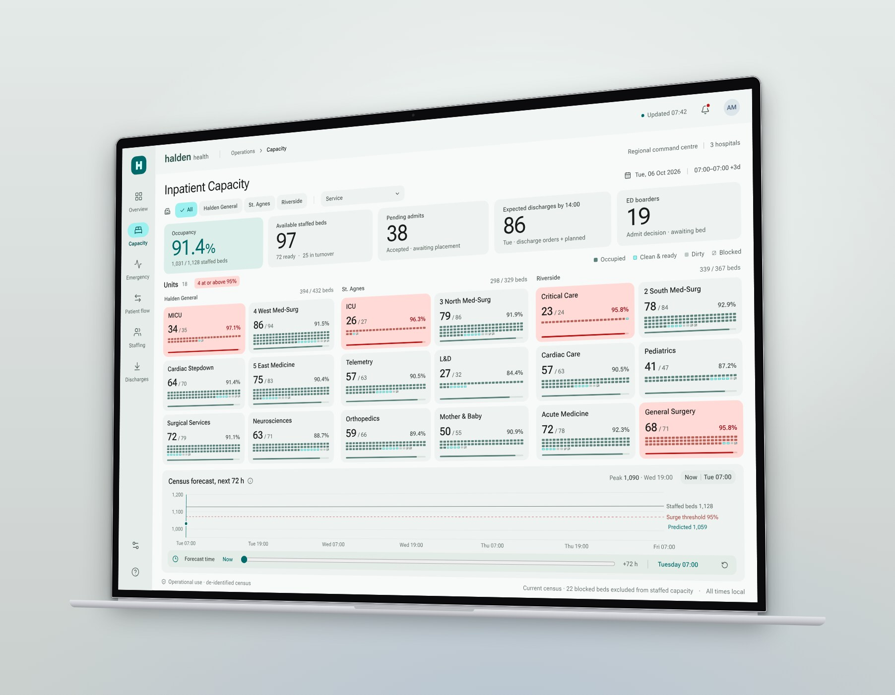
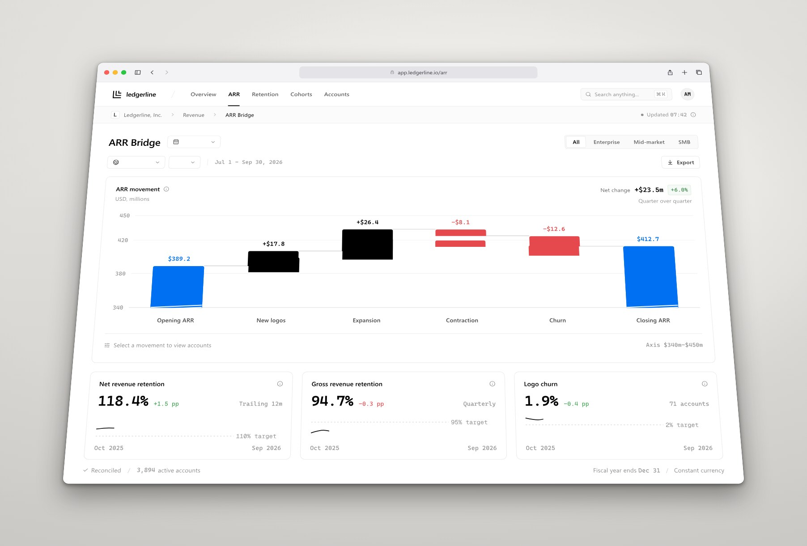
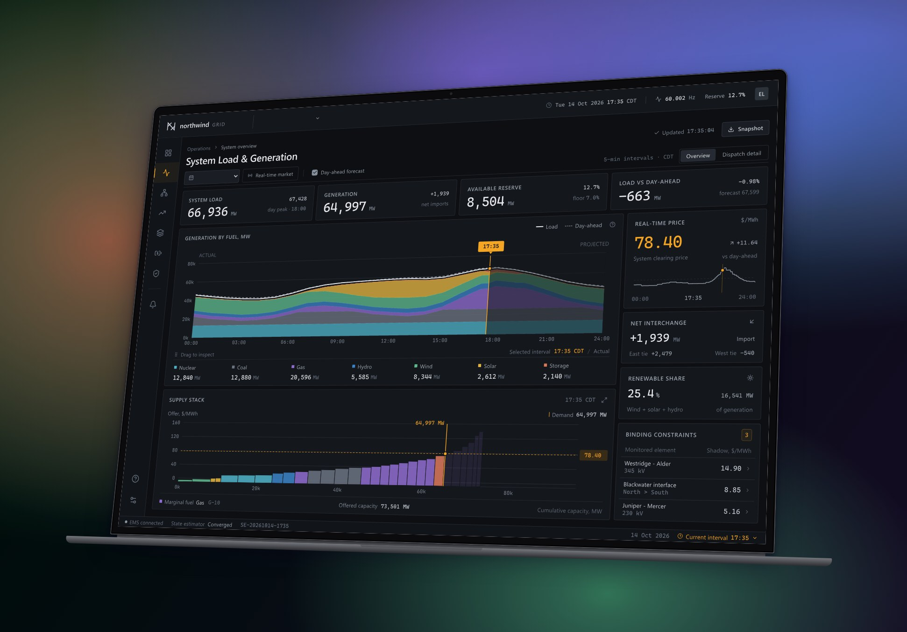

# Gallery

Things I've made with AI and design: apps, dashboards and experiments, each one small enough to read in an
afternoon and complete enough to run. Every folder in `apps/` stands on its own. Open it, `npm install`,
`npm run dev`, and take whatever is useful.

All data in these apps is made up.

<table>
<tr><td width="50%" valign="top"> <strong>Fieldstone Merchandising</strong> Merchandising analytics for an apparel retailer, with a markdown planner where you drag the price. <a href="apps/fieldstone-merchandising">Code</a></td><td width="50%" valign="top"> <strong>Halden Health</strong> A capacity command centre for a three-hospital health system, with a 72-hour forecast you can scrub through. <a href="apps/halden-health">Code</a></td></tr>
<tr><td width="50%" valign="top"> <strong>Ledgerline Revenue</strong> Revenue analytics for a software company: an ARR bridge that unfolds into accounts, and a cohort retention triangle. <a href="apps/ledgerline-revenue">Code</a></td><td width="50%" valign="top"> <strong>Meridian Treasury</strong> A treasury workstation: a 13-week cash forecast with what-if scenarios, and an FX exposure matrix. <a href="apps/meridian-treasury">Code</a></td></tr>
<tr><td width="50%" valign="top"> <strong>Northwind Grid</strong> A control room for a power grid operator. Drag one time cursor and the whole grid re-solves. <a href="apps/northwind-grid">Code</a></td></tr>
</table>

## Browse by tag

[Dark](#dark) · [Dashboard](#dashboard) · [Data apps](#data-apps) · [Energy](#energy) · [Finance](#finance) · [Healthcare](#healthcare) · [Light](#light) · [Retail](#retail) · [Saas](#saas)

### Dark

- **[Northwind Grid](apps/northwind-grid)**: A control room for a power grid operator. Drag one time cursor and the whole grid re-solves.

### Dashboard

- **[Fieldstone Merchandising](apps/fieldstone-merchandising)**: Merchandising analytics for an apparel retailer, with a markdown planner where you drag the price.
- **[Halden Health](apps/halden-health)**: A capacity command centre for a three-hospital health system, with a 72-hour forecast you can scrub through.
- **[Ledgerline Revenue](apps/ledgerline-revenue)**: Revenue analytics for a software company: an ARR bridge that unfolds into accounts, and a cohort retention triangle.
- **[Meridian Treasury](apps/meridian-treasury)**: A treasury workstation: a 13-week cash forecast with what-if scenarios, and an FX exposure matrix.
- **[Northwind Grid](apps/northwind-grid)**: A control room for a power grid operator. Drag one time cursor and the whole grid re-solves.

### Data apps

- **[Fieldstone Merchandising](apps/fieldstone-merchandising)**: Merchandising analytics for an apparel retailer, with a markdown planner where you drag the price.
- **[Halden Health](apps/halden-health)**: A capacity command centre for a three-hospital health system, with a 72-hour forecast you can scrub through.
- **[Ledgerline Revenue](apps/ledgerline-revenue)**: Revenue analytics for a software company: an ARR bridge that unfolds into accounts, and a cohort retention triangle.
- **[Meridian Treasury](apps/meridian-treasury)**: A treasury workstation: a 13-week cash forecast with what-if scenarios, and an FX exposure matrix.
- **[Northwind Grid](apps/northwind-grid)**: A control room for a power grid operator. Drag one time cursor and the whole grid re-solves.

### Energy

- **[Northwind Grid](apps/northwind-grid)**: A control room for a power grid operator. Drag one time cursor and the whole grid re-solves.

### Finance

- **[Ledgerline Revenue](apps/ledgerline-revenue)**: Revenue analytics for a software company: an ARR bridge that unfolds into accounts, and a cohort retention triangle.
- **[Meridian Treasury](apps/meridian-treasury)**: A treasury workstation: a 13-week cash forecast with what-if scenarios, and an FX exposure matrix.

### Healthcare

- **[Halden Health](apps/halden-health)**: A capacity command centre for a three-hospital health system, with a 72-hour forecast you can scrub through.

### Light

- **[Fieldstone Merchandising](apps/fieldstone-merchandising)**: Merchandising analytics for an apparel retailer, with a markdown planner where you drag the price.
- **[Halden Health](apps/halden-health)**: A capacity command centre for a three-hospital health system, with a 72-hour forecast you can scrub through.
- **[Ledgerline Revenue](apps/ledgerline-revenue)**: Revenue analytics for a software company: an ARR bridge that unfolds into accounts, and a cohort retention triangle.
- **[Meridian Treasury](apps/meridian-treasury)**: A treasury workstation: a 13-week cash forecast with what-if scenarios, and an FX exposure matrix.

### Retail

- **[Fieldstone Merchandising](apps/fieldstone-merchandising)**: Merchandising analytics for an apparel retailer, with a markdown planner where you drag the price.

### Saas

- **[Ledgerline Revenue](apps/ledgerline-revenue)**: Revenue analytics for a software company: an ARR bridge that unfolds into accounts, and a cohort retention triangle.

## Licence

MIT, unless an app's own README says otherwise.
