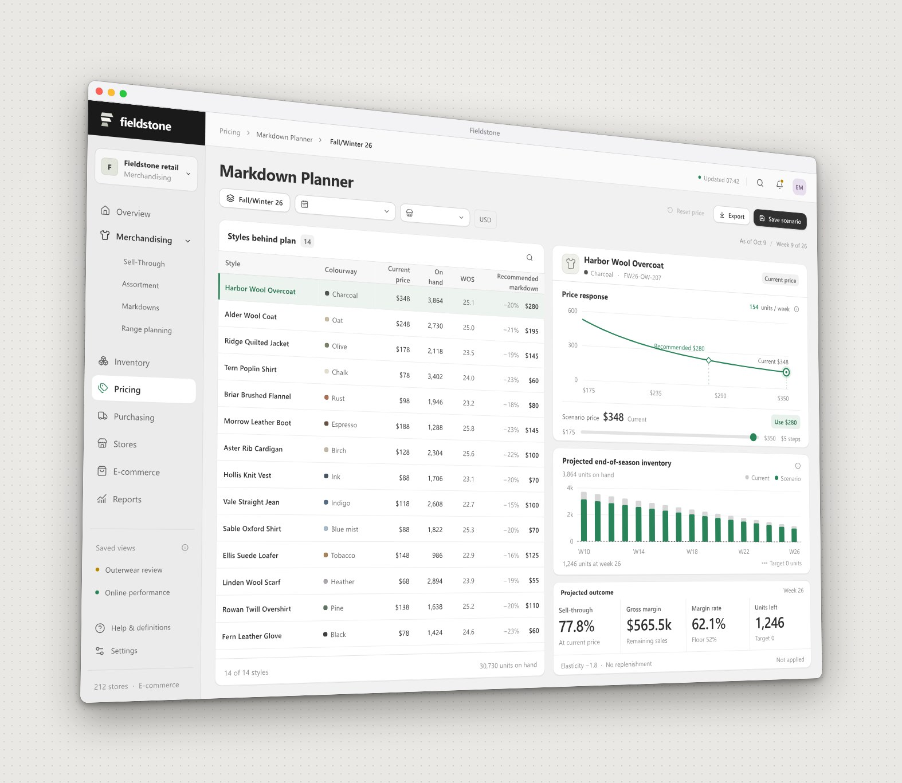

# Fieldstone Merchandising

Merchandising analytics for Fieldstone, a fictional specialty apparel retailer with 212 stores and an online shop. It's warm and tidy, after Shopify's Polaris: white cards on a soft grey ground, index tables and a single deep green for the series that matters.



## What to try

**Sell-Through.** Click a category in the revenue treemap to focus the sell-through curve, the size mix and weeks of supply on it.

**Markdown Planner.** Drag the price handle on the demand curve, or the slider under it, in $5 steps. Projected inventory, sell-through and margin recalculate live, and the margin rate turns to a caution colour below 52%.

## How it works

Demand responds to price with a constant-elasticity model (units = base x (price / base price) ^ -1.8), so the numbers move believably as you drag.

## Run it

```sh
npm install
npm run dev
```

Then open the address Vite prints. `npm run build` writes a static site to `dist/` that you can host anywhere.

## Built with

React, Framer Motion, Lucide icons, Recharts, Tailwind CSS, Vite. Each screen is designed at 1440 x 960 and scales down to fit smaller windows.

## Licence

MIT. All data is made up.
