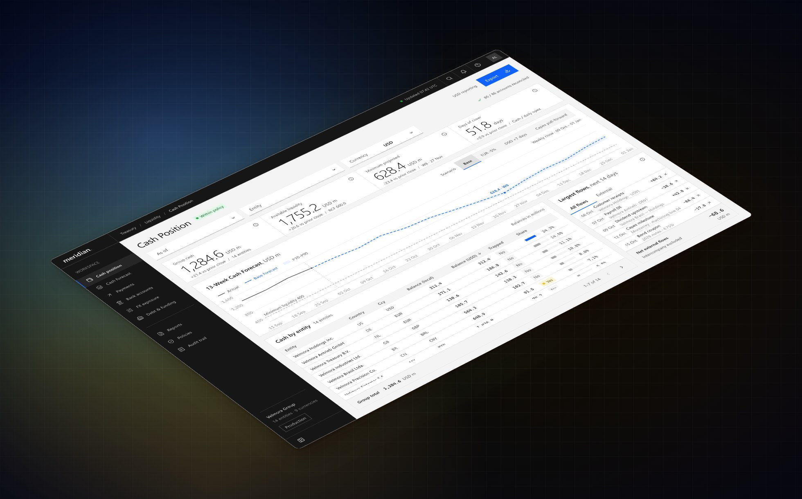

# Meridian Treasury

The treasury workstation of Meridian, a fictional industrial group with 14 legal entities and 9 currencies, reporting in US dollars. It follows the IBM Carbon idiom strictly: square corners, depth from layering and 1px borders, and a dark shell around light content.



## What to try

**Cash Position.** Switch scenario (Base, EUR -5%, DSO +7 days, capex pulled forward) and the forecast line and band morph to the new path. The low point glides to its new week, the line turns red where it breaches policy, and the entity table re-sorts.

**FX Exposure.** Net exposure by entity and currency as a heat matrix. Click a cell to open its 12-month hedge maturity ladder inline, while that currency's hedge ratio is highlighted.

## How it works

Balances, flows, exposures and hedges are invented for each entity and currency, and each scenario is a different path through the same 13 weeks.

## Run it

```sh
npm install
npm run dev
```

Then open the address Vite prints. `npm run build` writes a static site to `dist/` that you can host anywhere.

## Built with

React, Framer Motion, Lucide icons, Recharts, Tailwind CSS, Vite. Each screen is designed at 1440 x 960 and scales down to fit smaller windows.

## Licence

MIT. All data is made up.
